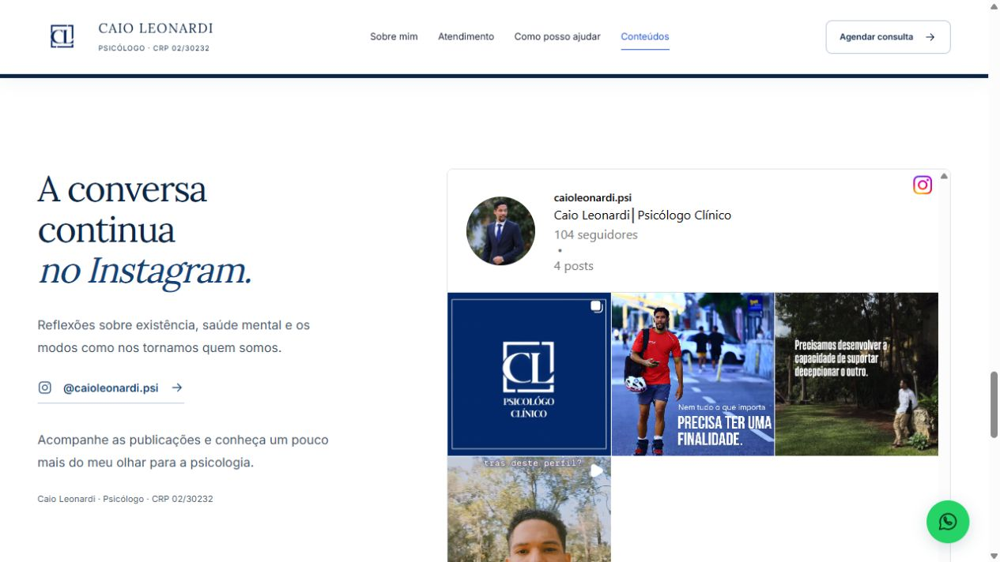
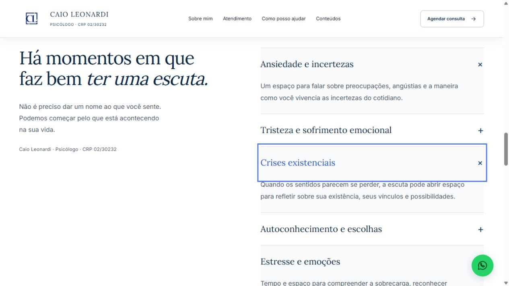

<div align="center">


# Caio Leonardi

### Psicologia clínica online. Presença, mesmo à distância.

Um site institucional para apresentar o profissional, acolher o primeiro contato<br>e levar o visitante diretamente ao agendamento pelo WhatsApp.

[](#tecnologia)
[](#identidade-visual)
[](#movimento-com-intenção)
[](#rodando-localmente)

[**Ver o site ↗**](https://caio-leonardi-psicologia-online.wittyphlox3.chatgpt.site/)
&nbsp; · &nbsp;
[Começar localmente](#rodando-localmente)
&nbsp; · &nbsp;
[Conhecer os recursos](#a-experiência)
&nbsp; · &nbsp;
[Personalizar](#personalização)

<sub>Caio Leonardi Oliveira de Barros · Psicólogo · CRP 02/30232</sub>

</div>

<br>


> **Uma presença pessoal, com espaço para a história de quem chega.**
> A marca CL, a fotografia autêntica e a composição editorial constroem uma apresentação sóbria e acolhedora. O contato tem um caminho claro: conversar diretamente com o profissional.

<details>
<summary><strong>Ver a versão mobile e o Instagram</strong></summary>

<br>

<table>
  <tr><th>Leitura no celular</th><th>Publicações reais</th></tr>
  <tr>
    <td width="30%" valign="top"></td>
    <td width="70%" valign="top"></td>
  </tr>
</table>

As imagens são capturas reais da implementação. O conteúdo do Instagram pode mudar desde a captura.

</details>

## A experiência

| Parte do site | O que entrega |
| --- | --- |
| **Abertura** | Retrato profissional, atendimento online, CRP e chamada para o WhatsApp. |
| **Sobre o profissional** | Apresentação pessoal, abordagem fenomenológica-existencial e formação fornecida pelo cliente. |
| **Como funciona** | Quatro etapas: contato, horário, preparação do ambiente e encontro online. |
| **Especialidades** | Temas de atendimento em um acordeão com abertura e fechamento progressivos. |
| **Instagram** | Publicações de [@caioleonardi.psi](https://www.instagram.com/caioleonardi.psi/), servidas pelo próprio Instagram. |
| **Contato** | Botões de agendamento, mensagem pré-formatada e WhatsApp flutuante. |
| **Privacidade** | Política própria, informação sobre conteúdo externo e identificação profissional. |

A navegação acontece por âncoras, em uma única página. A newsletter foi substituída pelo Instagram; esta versão não captura nome ou e-mail.

## Identidade visual

**Marinho estrutural. Cobalto nas ações. Fotografia como presença.**

| Token | Cor | Aplicação |
| --- | --- | --- |
| `--color-primary` | `#0B2545` | Abertura, rodapé e títulos. |
| `--color-secondary` | `#134074` | Ênfases, detalhes e links. |
| `--color-accent` | `#1D4ED8` | Ações em superfícies claras. |
| `--color-accent-hover` | `#1E40AF` | Resposta dos botões. |
| `--color-bg-main` | `#FFFFFF` | Fundo principal. |
| `--color-bg-alt` | `#F8FAFC` | Alternância de seções. |
| `--color-whatsapp` | `#25D366` | Contato flutuante. |

- **Lora** dá voz aos títulos e às passagens reflexivas.
- **Inter** sustenta a leitura, a navegação e os controles.
- Fontes em **WOFF2**, com subconjunto latino e hospedagem local.
- Retrato em **WebP**: versões de 640 e 1100 px, com aproximadamente **24 KB e 48 KB**.
- Texto explicativo principal em **16 px**, com composição adaptada ao celular.

O sistema visual está em [DESIGN.md](./DESIGN.md). O contexto e as decisões de produto estão em [PRODUCT.md](./PRODUCT.md).

## Movimento com intenção

A página combina uma abertura mais expressiva com interações breves:

- **Abertura:** entrada sequenciada dos textos, enquadramento do retrato e chegada da legenda.
- **Rolagem:** entradas discretas dos títulos e das etapas.
- **Ilustração:** os traços da seção sobre a abordagem se desenham ao entrar no campo de visão.
- **Interações:** rotação dos ícones, deslocamento das setas e abertura do menu.
- **Acordeão:** expansão em **540 ms** e fechamento em **440 ms**, com texto e ícone acompanhando a transição.

Ao abrir uma especialidade, a anterior fecha. Cliques rápidos invertem o acordeão a partir da altura atual. Ao terminar, a altura volta a ser automática. Redimensionar a página durante a transição finaliza o estado solicitado.

A preferência **`prefers-reduced-motion`** desativa os movimentos espaciais e o desenho dos traços; mudanças dessa preferência cancelam animações em andamento. O conteúdo permanece visível por padrão. Sem suporte à animação, `details` e `summary` mantêm o comportamento nativo.

<details>
<summary>Ver as especialidades</summary>



O contorno azul identifica o foco de teclado. A captura mostra o estado expandido; a transição pode ser vista no site.

</details>

## Tecnologia

| Camada | Implementação |
| --- | --- |
| Estrutura | HTML com landmarks, títulos, âncoras e controles nativos. |
| Apresentação | CSS com variáveis, Grid, Flexbox e media queries. |
| Comportamento | JavaScript nativo, Web Animations API e IntersectionObserver. |
| Conteúdo externo | Iframe de perfil público fornecido pelo Instagram. |
| Desenvolvimento | Servidor HTTP em Node.js, usando módulos nativos. |
| Publicação | Arquivos estáticos do diretório `dist/`. |

**Sem framework, compilação ou dependências npm.** A estrutura é pequena para facilitar manutenção e publicação. A incorporação do Instagram continua sendo um serviço externo.

## Rodando localmente

É necessário ter **Node.js e npm** disponíveis. O ambiente usado na validação executa **Node.js 24.21.0**.

```bash
git clone https://github.com/RafaelADSdev/Psicologo-Caio.git
cd Psicologo-Caio
npm run dev
```

Abra **[http://127.0.0.1:4173](http://127.0.0.1:4173)**.

Não é necessário executar `npm install`: não há dependências npm. Para encerrar o servidor, use `Ctrl+C` no terminal.

| Comando | Finalidade |
| --- | --- |
| `npm run dev` | Servir `dist/` localmente na porta 4173. |
| `npm run check` | Verificar a sintaxe de `dist/app.js` e `dist/config.js`. |

O servidor local é uma ferramenta de desenvolvimento. A publicação usa os arquivos estáticos diretamente.

## Estrutura

```text
Psicologo-Caio/
├── dist/                      # Arquivos prontos para hospedagem
│   ├── assets/                # Retratos, logo, fontes e licenças
│   ├── index.html             # Página institucional
│   ├── styles.css             # Identidade, layout e animações CSS
│   ├── app.js                 # Menu, movimentos e acordeão
│   ├── config.js              # Contato e mensagem do WhatsApp
│   ├── privacidade.html       # Política de privacidade
│   ├── robots.txt             # Diretivas para indexação
│   └── sitemap.xml            # URLs do site
├── docs/images/               # Capturas usadas neste README
├── scripts/serve.mjs          # Servidor de desenvolvimento
├── licenses/                  # Licenças das fontes
├── .openai/hosting.json       # Configuração da hospedagem atual
├── DESIGN.md                  # Sistema visual
├── PRODUCT.md                 # Contexto e decisões de produto
└── package.json               # Comandos locais
```

Apesar do nome `dist/`, os arquivos são mantidos diretamente nessa pasta: não há etapa de geração. Documentos pessoais e materiais de referência não fazem parte do repositório.

## Personalização

### WhatsApp

Edite [dist/config.js](./dist/config.js):

```javascript
window.SITE_CONFIG = Object.freeze({
  whatsapp: '5581988088277',
  message: 'Olá! Encontrei seu site e gostaria de informações sobre agendamento de consulta.'
});
```

Use o número com código do país e DDD, sem espaços ou pontuação. O JavaScript aplica contato e mensagem aos botões com `data-whatsapp`. Ao trocar o número, atualize também os links de fallback no HTML.

Esse arquivo é público: não coloque senhas ou tokens nele.

### Instagram

A seção `#conteudo` incorpora:

```text
https://www.instagram.com/caioleonardi.psi/embed/
```

As publicações aparecem **diretamente**, sem botão de permissão. O atributo `loading="lazy"` permite ao navegador adiar a conexão até a proximidade da seção. O iframe está no HTML e funciona sem o JavaScript do site.

**Novos posts não exigem editar o projeto.** O Instagram controla conteúdo, ordem, quantidade de publicações, cache e tempo de atualização. Não há garantia de atualização em tempo real.

O perfil precisa permanecer público e permitir incorporações. Bloqueadores, restrições do serviço ou exigência de login podem impedir a exibição; o link para abrir o perfil fica sempre disponível.

Para trocar o perfil, atualize o iframe, os links, o nome exibido e a política em `dist/index.html` e `dist/privacidade.html`.

### Conteúdo e aparência

| Alteração | Arquivo |
| --- | --- |
| Textos, formação, CRP e seções | [dist/index.html](./dist/index.html) |
| Cores, fontes, espaçamento e layout | [dist/styles.css](./dist/styles.css) |
| Animações de rolagem e acordeão | [dist/app.js](./dist/app.js) |
| Imagens e fontes | [dist/assets/](./dist/assets/) |
| Informações de privacidade | [dist/privacidade.html](./dist/privacidade.html) |

## Publicação

### Vercel

O arquivo [vercel.json](./vercel.json) configura o projeto como site estático, sem instalação ou compilação, publicando **`dist/`**. Ao importar este repositório, mantenha **Root Directory** na raiz do repositório. A pasta de saída já é definida pelo arquivo; não defina `dist/` também como raiz.

Sem essa configuração, a implantação pode terminar com sucesso e retornar 404 na página inicial, porque `index.html` está dentro de `dist/`, não na raiz do repositório.

Com a integração Git da Vercel, novos commits na branch de produção disparam novas implantações. Mudanças no site publicado pelo Sites continuam usando o fluxo separado dessa hospedagem.

### Hospedagem no Sites

O site está hospedado em **Sites**, com acesso privado para revisão:

**[caio-leonardi-psicologia-online.wittyphlox3.chatgpt.site](https://caio-leonardi-psicologia-online.wittyphlox3.chatgpt.site/)**

O acesso pode exigir autenticação. GitHub e hospedagem são destinos separados: enviar um commit ao GitHub, por si só, não atualiza o site hospedado.

Para outra hospedagem estática:

1. Use **`dist/`** como diretório de publicação.
2. Deixe a etapa de compilação vazia: os arquivos já estão prontos.
3. Atualize a URL canônica e a imagem Open Graph em `dist/index.html`.
4. Atualize os endereços em `dist/sitemap.xml` e `dist/robots.txt`.
5. Confira imagens, fontes, WhatsApp, Instagram e privacidade no domínio final.

## Verificação

Foram conferidos no navegador:

- Layout em desktop e celular, sem transbordamento horizontal nas larguras verificadas.
- Menu móvel, âncoras e mensagem pré-formatada do WhatsApp.
- Publicações reais do perfil correto, exibidas sem etapa de permissão.
- Abertura e fechamento do acordeão, cliques rápidos e uso por teclado.
- Liberação da altura ao terminar as transições e leitura no celular.

`npm run check` verifica **sintaxe**; não substitui testes de interface. Não há suíte automatizada de regressão. O código implementa movimento reduzido, mas não foi realizada uma auditoria integral de acessibilidade.

A meta **PageSpeed acima de 90** ainda não foi aferida na URL final. Nenhuma pontuação de desempenho é presumida neste repositório.

## Privacidade e conteúdo profissional

O site apresenta nome completo, CRP e aviso de que não realiza atendimento de emergência ou crise. Não há prontuário, cadastro de pacientes ou formulário de captação de e-mail.

O código próprio não instala analytics nem grava novas preferências locais. A incorporação automática do Instagram conecta o visitante à Meta, que pode tratar dados de navegação e usar cookies próprios. Esse comportamento está descrito na política do site.

Dados profissionais e formação foram fornecidos pelo cliente. A implementação não equivale a uma certificação jurídica ou de conformidade profissional.

## Créditos e materiais

- **Profissional:** Caio Leonardi Oliveira de Barros — CRP 02/30232.
- **Identidade e fotografia:** materiais fornecidos para o projeto.
- **Fontes:** Lora e Inter, sob SIL Open Font License; textos em [licenses/](./licenses/) e junto dos arquivos publicados.
- **Instagram:** conteúdo servido pelo perfil do profissional no próprio Instagram.

O projeto não define uma licença de código aberto para o conjunto. A marca, as fotografias e os textos profissionais não são apresentados como recursos livres para reutilização. As fontes possuem suas próprias licenças.

<details>
<summary>Referências consultadas</summary>

- [Meta Embeds — formatos de URL aceitos](https://github.com/meta/meta-embeds-for-wordpress#supported-url-formats).
- [Publicidade profissional — CFP/CRP](https://transparencia.cfp.org.br/crp10/pergunta-frequente/publicidade-profissional/).
- [LGPD — texto atualizado](https://www2.camara.leg.br/legin/fed/lei/2018/lei-13709-14-agosto-2018-787077-normaatualizada-pl.html).
- Composição visual: [Serotonin](https://www.taylorbowmanmft.com/), [Self Embrace Therapy](https://www.selfembracetherapy.com/) e [Earthbound](https://earthboundpsychotherapy.com/). Textos e fotografias desses sites não foram reutilizados.

</details>

---

<div align="center">

**Escuta. Presença. Possibilidades.**

[Voltar ao topo](#caio-leonardi)

</div>
